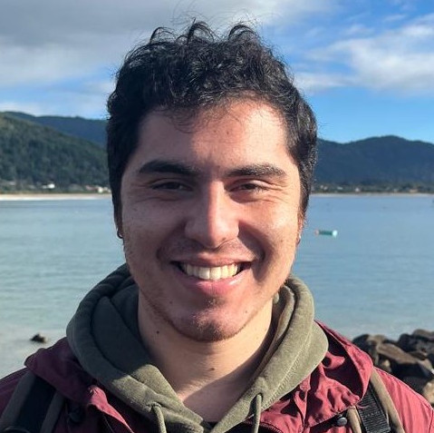

::: {.hero}
::: {.hero-copy}
# Felipe de León Sáenz Angel

## Postdoctoral Researcher

Universidad de Santiago de Chile

I am interested in applying methods from quiver representations and tropical geometry to the study of degenerations of linear series.

::: {.keywords}
Mustafin varieties · Quiver representations · Tropical convexity · Degenerations of linear series
:::

::: {.profile-links}
[Email](mailto:felipedeleon.math@gmail.com) · [CV](cv.qmd) · [Research](research.qmd)
:::
:::

::: {.portrait}
{.profile-photo}
:::
:::

## About

My research focuses on the geometry of linked projective spaces and their role in degenerations of linear series. In joint work with Eduardo Esteves, we use techniques from polymatroid theory to compute their Chow class, and in ongoing work with Eduardo Esteves and Eduardo Vital we study their multigraded Hilbert polynomial. A central open question is to understand precisely when linked projective spaces arise from geometric degenerations.

Mustafin varieties provide another natural class of degenerations closely related to these constructions. In ongoing work with Eduardo Esteves and Carlos Urtrecho, we compare the quiver representations underlying both settings and show that the relevant Deligne schemes can be interpreted in terms of linked projective spaces.

Finally, we apply these ideas to the geometry of linear series on reducible curves. In the $G^0_d$ project, we construct a moduli space whose fibers are linked projective spaces and relate it to the Hilbert scheme of points.

## Selected Research

### [Polymatroidal Tilings and the Chow Class of Linked Projective Spaces](https://londmathsoc.onlinelibrary.wiley.com/doi/10.1112/blms.70370)

*with Eduardo Esteves*

We use techniques from polymatroid theory to study linked projective spaces and prove that they have the Chow class of the diagonal.

### Linked projective spaces and Deligne schemes

*with Eduardo Esteves and Carlos Urtrecho — in preparation*

We study the quiver representations arising from convex lattice configurations associated with Deligne schemes. We introduce a combinatorial framework that captures their main structural properties and use it to relate Deligne schemes to linked projective spaces.

### The $G^0_d$-scheme for curves of compact type

*in preparation*

We construct a moduli space over the Jacobian of a nodal curve of compact type whose fibers are linked projective spaces, together with a natural morphism to the Hilbert scheme of points.

### Multigraded Hilbert polynomials of linked projective spaces

*with Eduardo Esteves and Eduardo Vital — in preparation*

We study the multigraded Hilbert polynomial of linked projective spaces with respect to their natural embedding in a product of projective spaces.

[Explore my research →](research.qmd){.more-link}
